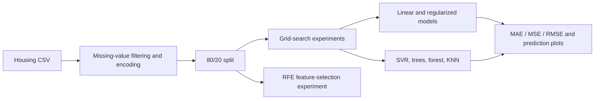

<div align="center">

# Ames Housing Analysis

### Compare house-price models through their errors.

**Regression · Cross-Validation · Feature Selection**


[Overview](#overview) · [Workflow](#workflow) · [Results](#results) · [Run Locally](#run-locally)


</div>

## Overview

A regression notebook that explores the **Ames Housing dataset** and compares multiple approaches to predicting `SalePrice`. It combines missing-data handling, categorical encoding, grid-search experiments, predicted-versus-actual plots, and error metrics.

The work is useful for learning how linear, regularized, tree-based, and neighborhood models respond to the same housing feature table.

## Data and Preparation

[AmesHousing.csv](AmesHousing.csv) is included. The notebook:

1. Drops columns with more than 400 missing values.
2. Label-encodes object columns.
3. Fills remaining numeric missing values with column means.
4. Removes `SalePrice`, `Yr Sold`, `Year Built`, and `Garage Yr Blt` from predictors.
5. Splits 80%/20% with `random_state=0`.

A StandardScaler is fitted in the notebook, but the displayed estimators are trained on the original encoded feature table.

## Workflow



## Models

| Family | Implemented Experiments |
|---|---|
| Linear | Linear Regression, Lasso, Ridge, ElasticNet |
| Margin-based | Support Vector Regression |
| Tree-based | Decision Tree, Random Forest |
| Neighborhood | K-Nearest Neighbors |
| Feature selection | Recursive Feature Elimination with Linear Regression |

GridSearchCV explores regularization, tree depth, neighbors, and SVR settings. Some chosen final parameters are specified separately from the search object.

## Results

Selected **saved test-error outputs**, in the target's price units:

| Model | MAE | RMSE |
|---|---:|---:|
| Linear Regression | 19,890.55 | 37,289.49 |
| Decision Tree | 25,322.47 | 39,726.69 |
| Random Forest | 17,342.88 | 30,068.74 |
| KNN | 26,226.81 | 39,239.37 |

The Random Forest has the lowest recorded MAE/RMSE among these rows. This is a historical notebook comparison, not an independent benchmark.

The forest cell prints `M5.score(...)`, which belongs to the Decision Tree. Its displayed R² is therefore not the forest's R². Lasso and Ridge also print training R² while several other models print test R²; these values should not be ranked together without recomputation.

The preview is the original Random Forest predicted-versus-actual scatter plot. Additional plots let you inspect how errors vary across the price range.

## Reproduction and Interpretation

Preprocessing is performed before splitting, which can leak information from the eventual test partition. Move imputation/encoding into a training-only pipeline for a cleaner evaluation.

The SVR search contains `"boly"`, an invalid kernel name; use the intended valid candidate when rerunning. Random Forest randomness is not fixed in the final model, so exact metrics can vary. RFE selects 15 features as a separate experiment.

## Run Locally

Clone the repository and create an isolated Python environment:

```bash
git clone https://github.com/ismailhalawa-ctrl/Ames-Housing-Analysis-.git
cd Ames-Housing-Analysis-
python -m venv .venv
```

```powershell
# Windows PowerShell
.\.venv\Scripts\Activate.ps1
```

```bash
# macOS / Linux
source .venv/bin/activate
```

```bash
python -m pip install numpy pandas matplotlib seaborn scikit-learn jupyterlab
jupyter lab "AmesHousing.ipynb"
```

Change `/content/AmesHousing.csv` to `AmesHousing.csv`. Review the SVR kernel candidates and metric-variable references before running the entire comparison.

Run cells from top to bottom in one kernel. The repository does not pin package versions; saved outputs reflect the original environment and are not a fresh benchmark. If a library API has changed, adapt that cell before continuing.

## Repository Guide

| File | Purpose |
|---|---|
| [AmesHousing.ipynb](AmesHousing.ipynb) | Analysis source, narrative, and recorded outputs |
| [AmesHousing.csv](AmesHousing.csv) | Included housing data |
| `README.md` | Project overview and reproduction guide |

The preview is an original saved notebook output, hosted in the [shared portfolio figure gallery](https://github.com/ismailhalawa-ctrl/Data-Analysis-Projects/tree/main/docs/figures). It has not been regenerated or used as evidence of a new experiment.

## Extending the Work

Keep preprocessing and model selection reproducible, record package versions, and validate changes against an appropriate baseline. The repository is a notebook study; it does not include a deployed prediction API or an automated regression suite.

---

Created by **[Ismail Halawa](https://github.com/ismailhalawa-ctrl)** · [Explore the portfolio](https://github.com/ismailhalawa-ctrl?tab=repositories)

